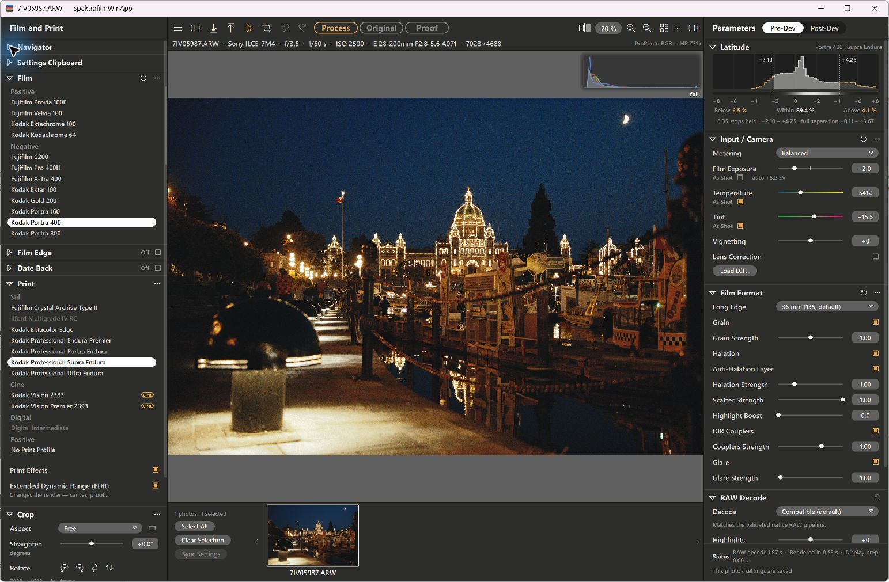

# SpektrafilmWinApp

**English** · [简体中文](README.zh-CN.md)

SpektrafilmWinApp is a digital darkroom for Windows. Open a RAW photograph, choose a film stock, then print the negative on a paper of your choice. The spectral model follows light through the film and paper, so you can change the exposure on the negative or keep that negative and make a different print.

This is an independently developed and maintained fork of [SpektraLab](https://github.com/JamesQiu2005/SpektraLab). The Windows editor and its releases live in this repository.



*Night waterfront from `7IV05987.ARW`, photographed by wuye9036. Developed with Kodak Portra 400 on Kodak Professional Supra Endura, film exposure −2 EV and Print EDR enabled. The photograph and its rendition are licensed under [CC BY-NC-SA 4.0](https://creativecommons.org/licenses/by-nc-sa/4.0/).*

## Make a first print

1. Press **Ctrl+O** to open a RAW, TIFF, JPEG or PNG. **Ctrl+Shift+O** opens a folder in the filmstrip.
2. Choose film and paper in the left panel. In **Pre-Dev**, adjust the RAW white balance and film exposure. Use the enlarger to change the print exposure or filtration.
3. Press **Y** to compare the result with the original. In **Post-Dev**, adjust the finished print with curves or colour wheels. Press **S** to soft-proof it in the export colour space.
4. Press **Ctrl+E** to choose a recipe and export JPEG, PNG or 16-bit TIFF. The editor saves adjustments for each photograph separately and preserves the source file.

## Inside the Windows editor

- **Interactive RAW development.** Temperature and tint update the GPU preview as you drag. When you finish, the editor refines the image at full resolution. Lens correction reads supported embedded Sony ARW and DNG distortion profiles or a rectilinear Adobe LCP you supply.
- **Film and paper.** Work with colour negatives, slides or black-and-white film. Film format sets the physical scale of grain and halation. On calibrated colour papers, Print EDR maps the paper’s additional highlight range into an SDR print.
- **Framing and film strips.** Use a crosshair, thirds or a square grid to frame a crop. Film Edge adds the stock’s rebate markings and Date Back exposes a date. Two half frames can share one strip and export as one picture.
- **Colour and export.** The editor works in ProPhoto RGB and uses the active monitor’s ICC profile. Soft proof and gamut warning show how a recipe handles colour before export. A batch can reuse one recipe for the selected photographs.

The interface is available in English, Simplified Chinese, Japanese and Spanish.

## Run or build

Use 64-bit Windows and a GPU with a Vulkan-capable driver. Release downloads are listed on [this fork’s releases page](https://github.com/wuye9036/SpektraLab/releases). For builds under the new name, run the x64 installer or extract the whole portable ZIP and launch **SpektrafilmWinApp.exe**. Earlier packages use the SpektraLab name.

To build from the repository root, install Visual Studio 2022 with Desktop development with C++, then prepare Qt, LibRaw and the shader tools as described in the [Windows build guide](windows_UI/README.md#build-msvc-2022).

```powershell
.\windows_UI\build-msvc.ps1 -SourceDirectory . -DependencyDirectory ..\deps -BuildDirectory .\_build\release -RunTests -Package
```

The script builds the editor, runs CTest and writes the portable ZIP under `_build/release/package/`. Use `-Installer` with Inno Setup 6 to also build the installer.

## Credits and licences

The application and engine are [GPL-3.0-or-later](license/LICENSE). Hanze Qiu and the SpektraLab contributors developed the upstream application and native engine. Andrea Volpato’s [spektrafilm](https://github.com/andreavolpato/spektrafilm) supplies the film and print model, the 28 colour profiles and the print LUTs. Those profiles and LUTs retain their [CC BY-SA 4.0 licence](license/SPEKTRAFILM_LICENSE.txt).

Hanze Qiu’s four black-and-white film profiles and Multigrade IV RC paper are documented in the [profile notice](engine/resources_product/NOTICE.md). Notices for Qt, LibRaw, fonts and other bundled components are available in the app’s About window and in the [Windows third-party notices](windows_UI/THIRD_PARTY.md).
