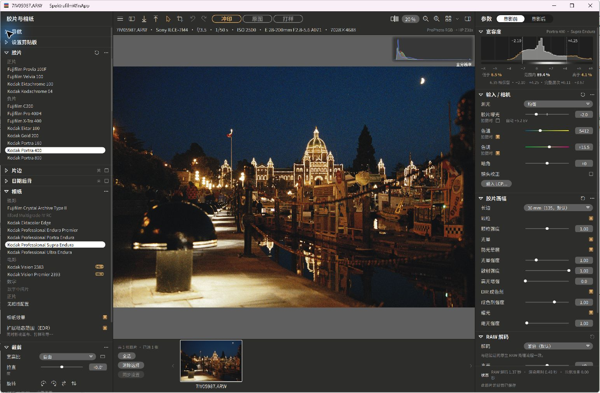

# SpektrafilmWinApp

[English](README.md) · **简体中文**

SpektrafilmWinApp 是一款 Windows 数字暗房。打开一张 RAW 照片，选定胶片，再选相纸放印。光谱模型模拟光线通过胶片和相纸的过程：你可以调整底片曝光，也可以保留同一张底片，换一种相纸或滤色重新放印。

本项目从 [SpektraLab](https://github.com/JamesQiu2005/SpektraLab) 分支而来，现已独立开发和维护。Windows 编辑器的开发和版本发布都在本仓库进行。



*码头夜景，原片 `7IV05987.ARW`，摄影：wuye9036。截图使用 Kodak Portra 400 胶片和 Kodak Professional Supra Endura 相纸，胶片曝光 −2 EV，已开启相纸 EDR。照片及此显影版本采用 [CC BY-NC-SA 4.0](https://creativecommons.org/licenses/by-nc-sa/4.0/) 授权。*

## 从一张 RAW 到第一张成片

1. 按 **Ctrl+O** 打开 RAW、TIFF、JPEG 或 PNG。按 **Ctrl+Shift+O** 可以打开整个文件夹，在胶片栏中选片。
2. 在左侧选择胶片和相纸，在右侧的**显影前**面板设置 RAW 白平衡和胶片曝光。要改变放印亮度或色调，可以调节放大机的曝光和滤色。
3. 按 **Y** 对照原片与成片。在**显影后**面板用曲线或色轮调整成片，按 **S** 软打样，预览选定导出色彩空间中的效果。
4. 按 **Ctrl+E** 选择导出配方，保存为 JPEG、PNG 或 16 位 TIFF。编辑参数按照片单独保存，保留原始文件。

## Windows 编辑器的功能

- **交互式 RAW 显影。** 拖动色温或色调时，GPU 预览随之更新；松手后，编辑器按完整分辨率细化图像。镜头畸变校正可读取受支持的 Sony ARW 和 DNG 内嵌数据，也可载入适用的 Adobe LCP 直线投影镜头配置文件。
- **胶片与相纸。** 可选彩色负片、反转片和黑白胶片。画幅大小决定颗粒和光晕的物理尺度。使用已标定的彩色相纸时，放印扩展动态范围（Print EDR）可将相纸额外的高光层次映射到 SDR 成片中。
- **构图与片边。** 裁剪时可叠加中心十字、三分线或方格。开启片边可显示对应胶片的边缘印字，日期后背可将日期曝光到画面中。两张半格照片可以拼在同一段胶片上，一起导出。
- **色彩与导出。** 编辑器在 ProPhoto RGB 空间中工作，按当前显示器的 ICC 配置显示照片。软打样和色域警告可预览导出配方对颜色的影响。选中多张照片即可按同一配方批量导出。

界面支持简体中文、英语、日语和西班牙语。

## 运行与构建

需要 64 位 Windows，以及支持 Vulkan 的显卡驱动。下载见[本项目的发布页](https://github.com/wuye9036/SpektraLab/releases)。SpektrafilmWinApp 从 **v1.0** 开始独立编号。可运行 x64 安装程序，也可将便携 ZIP 完整解压后启动 **SpektrafilmWinApp.exe**。早期安装包沿用 SpektraLab 名称。

从源码构建时，先安装 Visual Studio 2022 的「使用 C++ 的桌面开发」工作负载，再按 [Windows 构建指南](windows_UI/README.md#build-msvc-2022) 准备 Qt、LibRaw 和着色器工具。在仓库根目录运行：

```powershell
.\windows_UI\build-msvc.ps1 -SourceDirectory . -DependencyDirectory ..\deps -BuildDirectory .\_build\release -RunTests -Package
```

脚本构建编辑器、运行 CTest，并将便携 ZIP 写入 `_build/release/package/`。准备好 Inno Setup 6 后，使用 `-Installer` 还可生成安装程序。

## 致谢与许可

应用和引擎采用 [GPL-3.0-or-later](license/LICENSE)。上游应用和原生引擎由 Hanze Qiu 与 SpektraLab 贡献者开发。胶片与放印模型、28 份彩色配置文件以及放印 LUT 来自 Andrea Volpato 的 [spektrafilm](https://github.com/andreavolpato/spektrafilm)。这些彩色配置文件与 LUT 保留 [CC BY-SA 4.0 许可](license/SPEKTRAFILM_LICENSE.txt)。

Hanze Qiu 制作的四款黑白胶片和 Multigrade IV RC 相纸配置文件另有[数据来源说明](engine/resources_product/NOTICE.md)。Qt、LibRaw、字体等随附组件的声明可在应用的「关于」窗口或 [Windows 第三方许可清单](windows_UI/THIRD_PARTY.md) 中查看。
